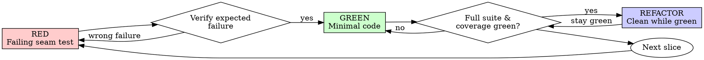

# Test-Driven Development (TDD)

Write the failing test first. Watch it fail. Write minimal code to pass. Refactor while green.

**Core principle:** If you did not watch the test fail on the missing behavior, you do not know whether it verifies the right contract.

## When to Use

**Always:** new features, bug fixes, behavior changes, and refactors (existing behavior pinned by tests first).
**Ask your human partner first only for:** throwaway prototypes (`prototype`), generated code, or non-executable config.

## The Iron Law

```text
NO PRODUCTION CODE WITHOUT A FAILING TEST FIRST
```

If production code was written before its test, delete the implementation code and implement fresh from the failing test (never keep untested implementation around to "adapt" afterward).

## Seams, Vocabulary & Vertical Slices

When exploring code before writing tests:
- Read `CONTEXT.md` (when present) so test names and assertions match the project's canonical domain terms (`Study`, `Subject`, `Site`, `Form`, `Record`, `Visit`, `Interval`, `Variable`, `Query`, `Data Dictionary`, `Job`), and respect relevant `docs/adr/` decisions.
- **Test at seams:** Observe behavior through public interfaces rather than reaching into private helpers or mocked internal collaborators. When the seam is already fixed by an approved spec/plan or existing public module, write the test immediately; pause to confirm seams with the user (referencing `codebase-design` vocabulary) **only** when the public interface itself is ambiguous or cross-cutting.
- **Work in vertical slices:** One seam, one failing behavior test, one minimal implementation per cycle. Never write bulk horizontal test files against imagined implementation details.

## Red-Green-Refactor Cycle



### 1. RED — Write One Failing Test

Target one observable behavior with an independent, hand-checked expectation (never compute expected values with production helpers):

```python
import httpx
import pytest
from imednet.errors import RateLimitError


def test_retry_operation_retries_transient_503_before_succeeding() -> None:
    attempts = 0

    def fetch_study_records() -> list[str]:
        nonlocal attempts
        attempts += 1
        if attempts < 3:
            raise httpx.HTTPStatusError(
                "retryable",
                request=httpx.Request("GET", "https://api.example/records"),
                response=httpx.Response(503),
            )
        return ["REC-001"]

    records = run_with_retry(fetch_study_records, max_attempts=3)

    assert records == ["REC-001"]
    assert attempts == 3
```

### 2. Verify RED (Mandatory)

```bash
pytest tests/unit/test_retry.py::test_retry_operation_retries_transient_503_before_succeeding -v
```

Confirm the test fails because the feature/fix is missing (not syntax, fixture, or import errors). If it passes immediately, you tested pre-existing behavior — fix the test before coding.

### 3. GREEN — Minimal Code

Write only enough idiomatic Python code to satisfy the failing test. Do not add unrequested flags, speculative abstractions, or extra config options.

### 4. Verify GREEN — Suite, Not Just One Test

Run the targeted test first, then run the package/repo test gate (`pytest --ignore=tests/live/` locally, and `hatch run verify-tests` for the `>=90%` coverage gate). Report any unrelated failures observed rather than omitting them.

### 5. REFACTOR — Clean Inside the Cycle

While tests stay green: remove duplication, tighten helper names, verify docstrings/types, and re-run tests + `ruff` / `mypy` without adding unverified behavior. Then move to the next vertical slice.

## Boundary Testing Standards (`imednet-toolkit`)

Consult [writing-good-tests.md](writing-good-tests.md) whenever writing or reviewing tests or fakes:
- Mock **only at system boundaries**: use `respx` strict routers (not ad-hoc monkeypatches or mock call-count assertions on internal methods) and `imednet.testing.fake_data` realistic payloads.
- Never add test-only hooks/methods onto production classes.
- Before finalizing tests, perform the mental mutation check (wrong branch, swapped constant, missing boundary condition -> at least one test must fail).

## Rationalizations & Red Flags

| Rationalization | Reality |
| --- | --- |
| "I'll test after; it's simple" | Tests-after immediately pass against existing bugs and lock in implementation coupling. |
| "I already read/manually ran it" | Manual checks leave zero regression guard; write the automated test first. |
| "Deleting this draft wastes sunk effort" | Keeping unverified code costs rework; delete and drive fresh from RED. |
| "Tests require mocking every internal collaborator" | Excessive mocks signal tight coupling; inject the external boundary dependency instead. |
| "Refactor later during review" | Clean while green inside the cycle so technical debt never compounds across slices. |

**Stop immediately if:** code exists without a failing test first, a test passes before implementation, assertions echo mock calls instead of behavior, or tests compute `expected` with production code.
